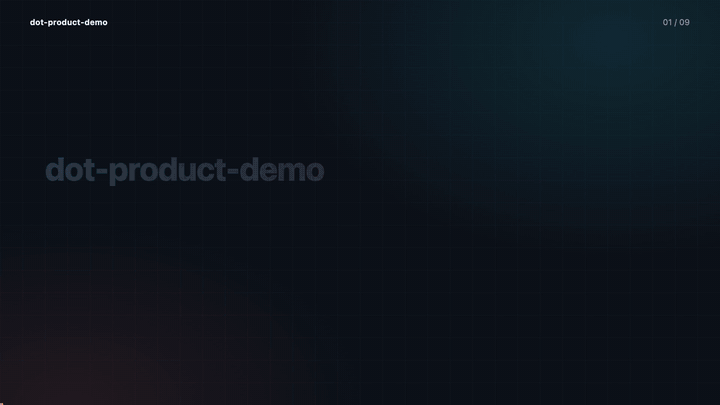
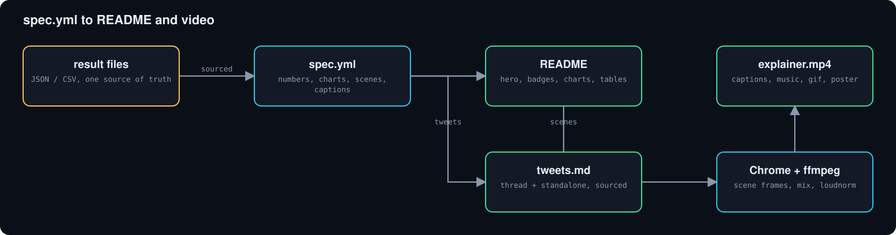

<div align="center">



# 🎬 video-readme-maker

**Turn any project's result files into a polished README, a silent captioned explainer video and launch tweets.**

   

[🚀 Usage](#usage) · [🐦 Tweets](#tweets) · [📖 spec.yml reference](#spec-reference) · [🧩 How it works](#how-it-works) · [⚠️ Honest caveats](#caveats) · [🗺️ Repo map](#repo-map)

</div>

---

**What the toolkit produces from `examples/demo` (under a minute)**

[](assets/explainer.mp4)

Write one `spec.yml` that points at your result files. One command produces a GitHub README (hero, badges, nav, tables, charts, architecture diagram,
caveats, repo map) and a 1080p explainer video (no voice-over: burned-in captions and generated music), a poster, an animated GIF preview
and ready-to-post tweets (a launch thread plus standalone tweets). **Every number comes from a result file; the generator fails loudly if one is missing.**

<a id="usage"></a>

## 🚀 Usage

```bash
git clone https://github.com/Bobliuuu/video-readme-maker ~/video-readme-maker
pip install -r ~/video-readme-maker/requirements.txt
(cd ~/video-readme-maker/video && npm install)      # puppeteer-core; uses your installed Chrome (or set CHROME=/path)
cd your-project && cp ~/video-readme-maker/examples/demo/spec.yml .     # edit it
python3 ~/video-readme-maker/vrm.py all spec.yml     # README.md + assets/ (hero, charts, mp4, poster, gif, srt)
```
Other commands: `vrm.py readme spec.yml`, `vrm.py video spec.yml`, `vrm.py tweets spec.yml`, `vrm.py verify assets/explainer.mp4`.
The tiny project in [`examples/demo`](examples/demo) renders end to end in about two minutes.

<a id="tweets"></a>

## 🐦 Tweets

`vrm.py tweets spec.yml` (also run by `all`) writes `tweets.md` and `tweets.json`: a launch thread (hook with the video, problem, idea, results, caveats,
repo link) plus standalone tweets, one per headline number. Every number is sourced, every tweet is checked against the 280 weighted-character limit
(URLs count 23) and linted for IPs, keys and failed-run stories. Nothing is posted; copy from `tweets.md`.
Override the auto thread with a `tweets:` block (`thread: [{text, media}]`, `singles`, `hashtags`, `handle`, `out`).

<a id="spec-reference"></a>

## 📖 spec.yml reference

| Key | Purpose |
|---|---|
| `project`, `hero`, `theme` | Name, emoji, tagline, repo; hero card text and chips; accent colors. |
| `badges` | shields.io badges (`label`, `message`, `color`, `logo`, `link`); messages may use `{{ n.x }}`. |
| `numbers` | `name: {file, path, unit, fmt}` or `{expr: "a / b"}`. `path` digs into JSON (`runs.name=ours.ms` selects a list row by field); CSV rows work the same. |
| `tables` | `file`, `rows_path`, `columns: [{key, title, unit, fmt, align}]`, `highlight`. Source line is added automatically. |
| `charts` | `type: bar` (from `items` of numbers or file rows), `line` (series), `scatter` (speed versus accuracy). Pure SVG, readable on light and dark. |
| `diagrams` | `nodes: [{id, label, sub, col, row, kind}]`, `edges: [{from, to, label}]`. |
| `sections_dir` | Folder of verbatim `NN-name.md` files, each starting `# emoji Title`; each becomes a README section, new files are picked up automatically. |
| `sections` | `title`, `emoji`, `body`, `highlights`, `tables`, `charts`, `diagrams`, `details`. Also `compare`, `quickstart`, `caveats`, `repo_map`. |
| `tweets` | Optional: `thread`, `singles`, `hashtags`, `handle`, `out`. |
| `video` | `url` (GitHub user-attachments URL, rendered inline), `caption`, `fps`, `music`, `max_mb`, `scenes`. |
| scene `type` | `title problem idea architecture chart table code terminal stat comparison results caveats end`; each has `say:` caption text (templated, shown not spoken) and its own fields. |

Every string in the spec is a Jinja template with `n.<name>` bound to the sourced numbers, so captions, README, video and tweets always agree.

<details>
<summary>Embedding the video on GitHub</summary>

GitHub renders a bare `https://github.com/user-attachments/assets/<id>` URL on its own line as an inline player. That URL is created only by
dragging the mp4 into a GitHub issue, PR or README editor in the browser (there is no API for it). Until `video.url` is set, the README shows
the animated GIF preview, which links to the mp4.

</details>

<a id="how-it-works"></a>

## 🧩 How it works

<p align="center"></p>

<a id="caveats"></a>

## ⚠️ Honest caveats

- Frame rendering uses headless Chrome plus ffmpeg, so both must be installed; a 45 s video renders in about two minutes on a laptop.
- The preview GIF is a time-compressed overview, not real-time.

<a id="repo-map"></a>

## 🗺️ Repo map

| Path | What it is |
|---|---|
| `vrm.py` | command line entry point |
| `common/` | spec loading, number tracing, leak lint |
| `readme/` | README, hero, chart and diagram generators |
| `tweets/` | tweet thread and standalone tweet generator |
| `video/` | scene player, renderer, music |
| `examples/demo/` | tiny end-to-end project |
| `skill/SKILL.md` | Claude Code skill that drives the toolkit |

---

<div align="center"><sub>Built with its own generator.</sub></div>
