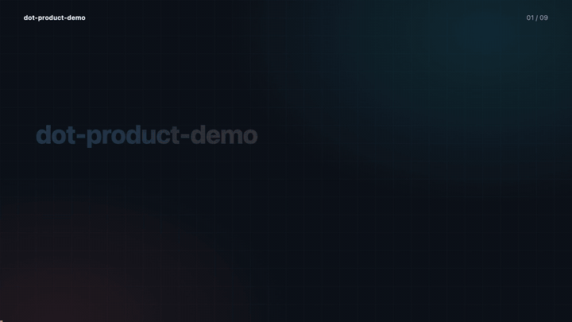
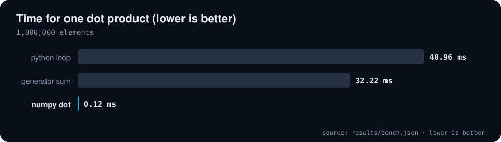
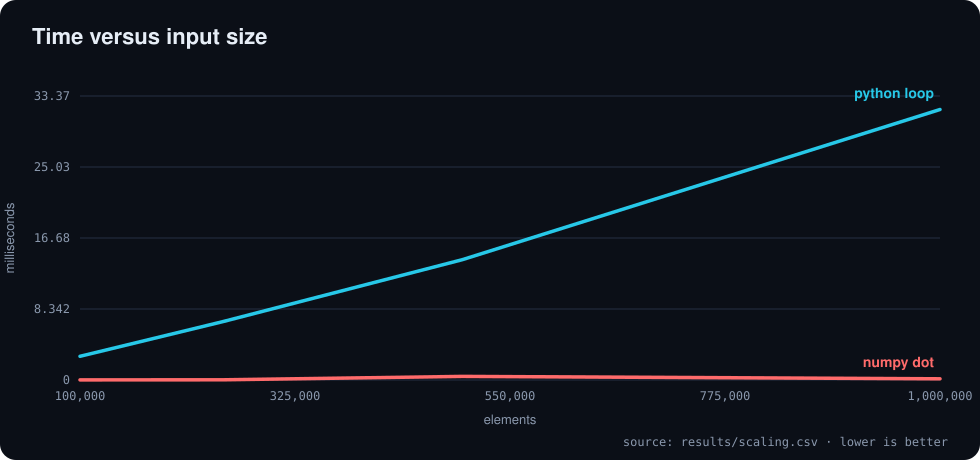
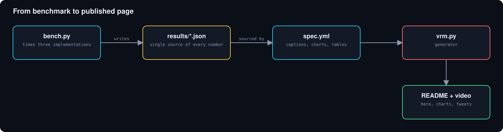

<div align="center">



# ⚡ dot-product-demo

**Three ways to multiply a million numbers, measured on this machine.**

  [](https://github.com/Bobliuuu/video-readme-maker)

[📊 Results](#results) · [🧩 How it works](#architecture) · [🚀 Quick start](#quick-start) · [⚠️ Honest caveats](#caveats) · [🗺️ Repo map](#repo-map)

</div>

---

**Explainer (under a minute): the problem, the idea, the numbers**

[](assets/explainer.mp4)

A deliberately small project that shows the whole toolkit: a benchmark writes `results/*.json`, `spec.yml` names every number,
and one command produces this README and a captioned explainer video.

<a id="results"></a>

## 📊 Results

| Speedup | numpy dot | python loop |
|:---:|:---:|:---:|
| **341.3x** | **0.12 ms** | **40.96 ms** |

**One million elements**

| Implementation | Time | Relative error |
| :--- | ---: | ---: |
| python loop | 40.96 ms | 2.0e-14 |
| generator sum | 32.22 ms | 3.5e-16 |
| **numpy dot** | **0.12 ms** | **0.0e+00** |

<sub>Source: `results/bench.json`</sub>

<p align="center"></p>

<p align="center"></p>

<a id="architecture"></a>

## 🧩 How it works

The benchmark is `bench.py`; the generator reads its output and never invents a number.

<p align="center"></p>

<details>
<summary>Where each number comes from</summary>

`speedup`, `numpy_ms`, `loop_ms` and friends are declared under `numbers:` in `spec.yml` with a file and a path.

</details>

<a id="quick-start"></a>

## 🚀 Quick start

**Run the benchmark and build everything**

```bash
python3 bench.py
python3 ../../vrm.py all spec.yml
```

<a id="caveats"></a>

## ⚠️ Honest caveats

- Timings come from one machine and one session, best of several repetitions.
- Absolute numbers will differ on your hardware; the ratio is what matters.

<a id="repo-map"></a>

## 🗺️ Repo map

| Path | What it is |
|---|---|
| `bench.py` | the benchmark that produces the result files |
| `results/` | bench.json and scaling.csv: the source of every number |
| `spec.yml` | drives the README and the video |
| `assets/` | generated hero, charts, diagram, video, poster, preview gif |

---

<div align="center"><sub>Generated with video-readme-maker.</sub></div>
